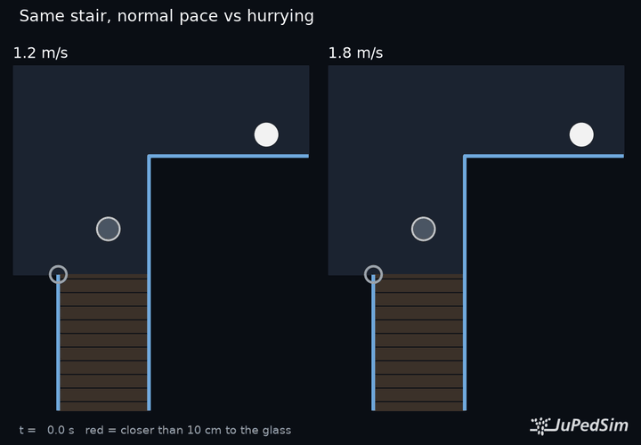

# copenhagen-stair

JuPedSim study of a column at the top of a stair at Copenhagen Airport: does it make
the turn onto the stair harder? The stair head is rebuilt from photos (dimensions are
estimates) and simulated with and without the column, using three JuPedSim models
(social force, WarpDriver, collision-free speed).

Write-up: [pedestriandynamics.org/notes/copenhagen-stair](https://pedestriandynamics.org/notes/copenhagen-stair/)



Results: figures in `figures/`, clips in `media/` (red = closer than 10 cm to the glass).

## Run

```sh
uv venv .venv && uv pip install --python .venv/bin/python -e ".[dev]"
.venv/bin/python scripts/run_study.py     # simulations -> results/*.csv (~15 min)
.venv/bin/python scripts/make_figures.py  # figures/
.venv/bin/python scripts/make_media.py    # media/*.mp4|gif (needs ffmpeg)
.venv/bin/pytest -q
```

`run_study.py` and `make_media.py` take names to run a subset, e.g. `run_study.py speed crowd`.

- `src/kopenhagen/geometry.py`: plan of the stair head and the estimated dimensions
- `src/kopenhagen/simulate.py`: one JuPedSim run
- `src/kopenhagen/metrics.py`: gap to the glass, angle onto the stair, crowd measures
